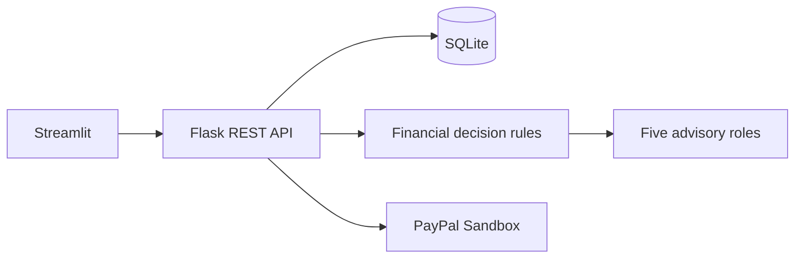

# PayAhead

**Think Before You Spend. Buy When It Makes Sense.**

A local financial decision MVP with a Streamlit interface, Flask API, SQLite database, JWT accounts, CSV transaction import, deterministic affordability scenarios, curated 20-item demo catalogue, five selectable sample profiles, 1,000 labeled synthetic transactions, five specialist analysis roles with saved activity, purchase watches with alerts, a reproducible expense classifier, anomaly review, synthetic price trend demonstration, scheduled watch checks, and server-side PayPal Sandbox order/capture endpoints.

## Architecture



## Setup

Requirements: Python 3.11+.

```powershell
Copy-Item .env.example .env
python -m venv .venv
.venv\Scripts\Activate.ps1
pip install -r backend/requirements.txt
```

Start the backend in one terminal from the repository root:

```powershell
python backend/app.py
```

Start Streamlit in another terminal:

```powershell
streamlit run frontend/streamlit_app.py
```

Open the URL Streamlit prints (usually `http://localhost:8501`). The API defaults to `http://localhost:5000/api`. Set `PAYAHEAD_API_URL` to change it. SQLite initializes automatically.

Copy `.env.example` to `.env`; set unique local secrets. Sandbox checkout also needs `PAYPAL_CLIENT_ID` and `PAYPAL_CLIENT_SECRET`. It never reports a simulated successful payment.

## Workflows and checks

Explore the clearly labeled synthetic profile without signing in. Register/login in the sidebar to save a personal profile. Update monthly income, expenses, savings, debt, and currency from Overview. Save category, budget, currency, and brand preferences under Preferences. Import UTF-8 CSV with `date`, `amount`, and optional `description`, `name`, or `merchant`. Add products manually or preview a public product page; extracted fields must be reviewed and confirmed before save. Explore the catalogue, price demo, and purchase assessment. Train the synthetic expense classifier with `python backend/scripts/train_models.py`; evaluate synthetic price trend holdouts with `python backend/scripts/evaluate_price_model.py`. Run backend checks with `python -m pytest backend/tests` and Streamlit UI smoke tests with `python -m pytest frontend/tests`. Set `ENABLE_SCHEDULER=true` to check saved watches hourly; a manual check is also available in Streamlit.

For PayPal use Sandbox buyer credentials; see `docs/PAYPAL_INTEGRATION.md`. The Streamlit flow handles the PayPal approval return and asks Flask to capture and verify the order. The API flow is covered by mocked tests; a real Sandbox checkout still requires credentials and interactive buyer approval.

## AI and limitations

Finance numbers are deterministic. Five specialist functions return structured evidence; optional LLM providers explain the deterministic result and cannot change its numbers or authorize payment. Historical transactions imported by a user feed a simple monthly net average when at least 30 rows exist; this is a baseline estimate, not a learned cash-balance forecast. Expense imports use the trained classifier when its model artifact exists, with a keyword fallback. Sample transactions and catalogue prices are synthetic/illustrative and are clearly labeled. Product price history and its linear trend demo use generated data, not verified retailer observations. No deep-learning model, automated retailer price feeds (URL previews extract public metadata only), or PayPal webhook verification is included. Classic ML is used for the current tabular/synthetic tasks; deep-learning frameworks would add complexity without suitable real training data in this local demo. An Isolation Forest marks unusual imported expense amounts after 30+ rows; flags require manual review. Purchase watches produce in-app alerts when manually checked or when `ENABLE_SCHEDULER=true` runs its hourly evaluator against local catalogue/profile data. Sandbox credentials are required to test payment approval and capture end to end. Scenario estimates are not guaranteed balances. Advice is educational, not financial advice. Never use live payment credentials.

See [architecture](docs/ARCHITECTURE.md), [AI provider setup](docs/AI_PROVIDERS.md), [API](docs/API.md), [AI models](docs/AI_MODELS.md), [PayPal](docs/PAYPAL_INTEGRATION.md), [security](docs/SECURITY.md), and [demo](docs/DEMO_GUIDE.md).
