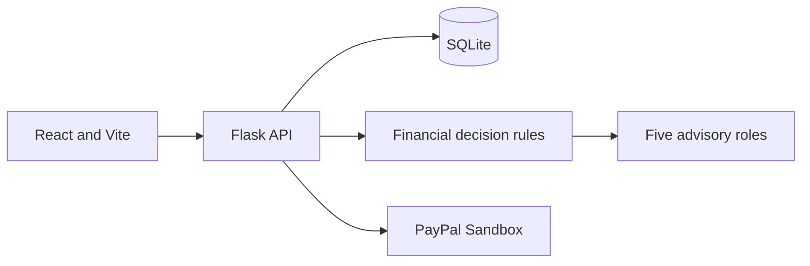

# PayAhead

**Think Before You Spend. Buy When It Makes Sense.**

An AI-assisted personal finance decision MVP: React dashboard, demo profile, user accounts, CSV import, deterministic affordability and scenarios, curated products, five specialist findings, a purchase-watch API, optional synthetic classifier training, and server-side PayPal Sandbox Orders v2 integration.

## Architecture



## Setup

Requirements: Python 3.11+ and Node.js 20+.

```powershell
Copy-Item .env.example .env
python -m venv .venv
.venv\Scripts\Activate.ps1
pip install -r backend/requirements.txt
cd frontend
npm install
npm run dev
```

In a second terminal, from the repo root, run `python backend/app.py`. SQLite initializes automatically. UI `http://localhost:5173`, API `http://localhost:5000`. Vite can use `VITE_API_URL` when the API is elsewhere.

Copy `.env.example` to `.env`; set unique local secrets. Sandbox checkout also needs `PAYPAL_CLIENT_ID` and `PAYPAL_CLIENT_SECRET`. There is no mock-success path.

## Workflows and checks

Explore demo data without signing in. Register/login for an isolated saved profile. Import UTF-8 CSV with `date`, `amount`, and optional `description`/`name`/`merchant`. Browse products and request an affordability review. Train the optional synthetic expense model with `python backend/scripts/train_models.py`; it reports a true held-out split of generated synthetic examples. Run backend checks with `python -m pytest backend/tests`; frontend build with `cd frontend; npm run build`.

For PayPal use Sandbox buyer credentials; see `docs/PAYPAL_INTEGRATION.md`. The frontend return callback is not yet wired to the capture endpoint.

## AI and limitations

Finance numbers are deterministic. Five analysis roles return structured findings, but are not separate LLM calls. Price prediction is unavailable without product history. The optional classifier is synthetic and not connected to CSV import. No deep-learning model, anomaly classifier, learned forecast, external retailer search, webhook verification, or registered-user frontend is included. Scenario estimates are not guaranteed balances. Advice is educational and not financial advice. Never use live credentials.

See [architecture](docs/ARCHITECTURE.md), [API](docs/API.md), [AI models](docs/AI_MODELS.md), [PayPal](docs/PAYPAL_INTEGRATION.md), [security](docs/SECURITY.md), [demo](docs/DEMO_GUIDE.md).
