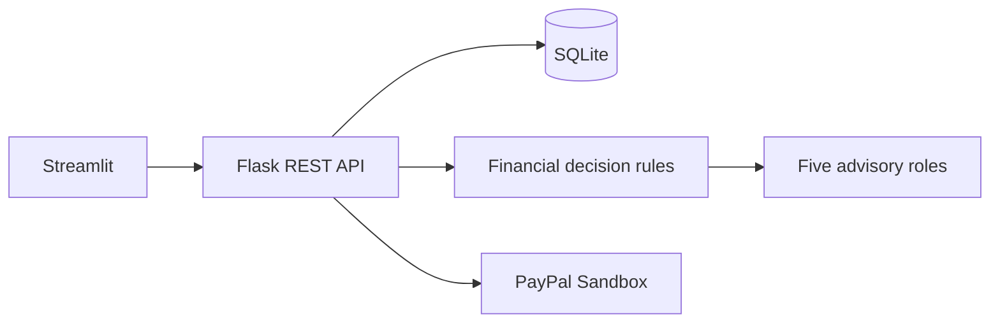

# PayAhead

**Think Before You Spend. Buy When It Makes Sense.**

A local financial decision MVP with a Streamlit interface, Flask API, SQLite database, JWT accounts, CSV transaction import, deterministic affordability scenarios, curated 20-item demo catalogue, five selectable sample profiles, 1,000 labeled synthetic transactions, five specialist analysis roles, purchase watches, a reproducible expense classifier, and server-side PayPal Sandbox order/capture endpoints.

## Architecture



## Setup

Requirements: Python 3.11+.

```powershell
Copy-Item .env.example .env
python -m venv .venv
.venv\Scripts\Activate.ps1
pip install -r backend/requirements.txt
```

Start the backend in one terminal from the repository root:

```powershell
python backend/app.py
```

Start Streamlit in another terminal:

```powershell
streamlit run frontend/streamlit_app.py
```

Open the URL Streamlit prints (usually `http://localhost:8501`). The API defaults to `http://localhost:5000/api`. Set `PAYAHEAD_API_URL` to change it. SQLite initializes automatically.

Copy `.env.example` to `.env`; set unique local secrets. Sandbox checkout also needs `PAYPAL_CLIENT_ID` and `PAYPAL_CLIENT_SECRET`. It never reports a simulated successful payment.

## Workflows and checks

Explore the clearly labeled synthetic profile without signing in. Register/login in the sidebar to save a personal profile. Update monthly income, expenses, savings and debt from Overview. Import UTF-8 CSV with `date`, `amount`, and optional `description`, `name`, or `merchant`. Explore products and run a cash-flow assessment. Train the optional synthetic expense model with `python backend/scripts/train_models.py`; it reports held-out scores on generated data only. Run backend checks with `python -m pytest backend/tests`.

For PayPal use Sandbox buyer credentials; see `docs/PAYPAL_INTEGRATION.md`. Order creation and capture are on the Flask API; the Streamlit flow links to PayPal approval but does not yet process the return callback.

## AI and limitations

Finance numbers are deterministic. Five analysis roles return structured findings, not separate LLM calls. Historical transactions imported by a user feed a simple monthly net average when at least 30 rows exist; this is a baseline estimate, not a learned cash-balance forecast. Expense imports use the trained classifier when its model artifact exists, with a keyword fallback. Sample transactions and catalogue prices are synthetic/illustrative and are clearly labeled. No verified product price history, deep-learning model, live retailer research, or PayPal webhook verification is included. An Isolation Forest marks unusual imported expense amounts after 30+ rows; flags require manual review. Purchase watches are saved but do not trigger a background notification scheduler. Sandbox credentials are required to test payment approval and capture end to end. Scenario estimates are not guaranteed balances. Advice is educational, not financial advice. Never use live payment credentials.

See [architecture](docs/ARCHITECTURE.md), [API](docs/API.md), [AI models](docs/AI_MODELS.md), [PayPal](docs/PAYPAL_INTEGRATION.md), [security](docs/SECURITY.md), and [demo](docs/DEMO_GUIDE.md).
