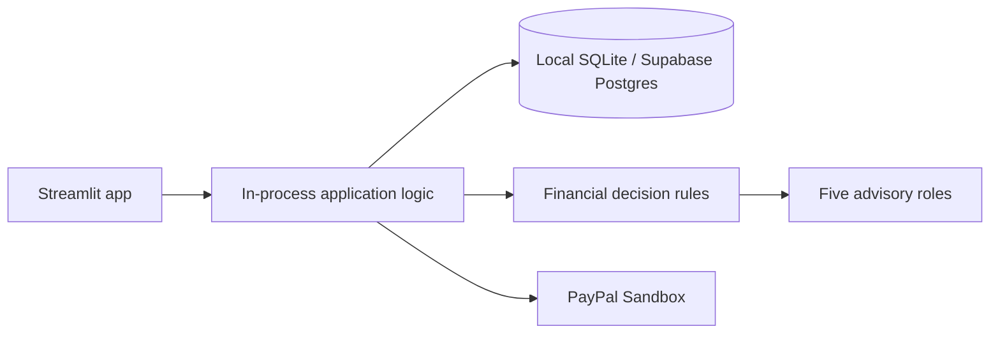

# PayAhead

**Think Before You Spend. Buy When It Makes Sense.**

A financial decision MVP with a Streamlit interface and in-process application logic, local SQLite or hosted Supabase Postgres storage, JWT accounts, CSV transaction import, deterministic affordability scenarios, curated 20-item demo catalogue, five selectable sample profiles, 1,000 labeled synthetic transactions, five specialist analysis roles with saved activity, purchase watches with alerts, a reproducible expense classifier, anomaly review, synthetic price trend demonstration, scheduled watch checks, and server-side PayPal Sandbox order/capture endpoints.

## Architecture



## Setup

Requirements: Python 3.11+.

```powershell
Copy-Item .env.example .env
python -m venv .venv
.venv\Scripts\Activate.ps1
pip install -r backend/requirements.txt
```

Run the app from the repository root:

```powershell
streamlit run frontend/streamlit_app.py
```

Open the URL Streamlit prints (usually `http://localhost:8501`). The Streamlit app calls PayAhead's application logic in-process, so a separate Flask server is not needed. Local development uses SQLite by default.

Copy `.env.example` to `.env` and set unique local secrets. Sandbox checkout also needs `PAYPAL_CLIENT_ID` and `PAYPAL_CLIENT_SECRET`. It never reports a simulated successful payment.

### Deploy the single Streamlit app

The UI and application logic run inside the Streamlit app process. For persistent hosted data, this project is configured to use **Supabase Postgres**; it uses local SQLite when no `DATABASE_URL` is supplied. Streamlit Community Cloud does not guarantee that local file storage persists, so configure Postgres before using saved accounts or financial data there ([Streamlit storage guidance](https://docs.streamlit.io/develop/concepts/connections/connecting-to-data)).

1. Push the repository to GitHub. Keep `.streamlit/secrets.toml` and `.env` out of Git.
2. Create a Supabase project. In **Connect**, copy the **Session pooler** URI. This mode supports IPv4-only networks, which is useful for hosted app connections ([Supabase connection options](https://supabase.com/docs/guides/database/connecting-to-postgres)).
3. In Streamlit Community Cloud, create an app from this repository and set the entrypoint to `frontend/streamlit_app.py`. Select Python 3.12 in Advanced settings. The root `requirements.txt` installs deployment dependencies ([Community Cloud deployment guide](https://docs.streamlit.io/deploy/streamlit-community-cloud/deploy-your-app/deploy)).
4. In the app's **Secrets** settings, paste the keys shown in `.streamlit/secrets.toml.example`. Use the connection values from Supabase, URL-encode special characters in the database password, and use the `postgresql+psycopg://` URL prefix with `sslmode=require`. Generate different long random values for `SECRET_KEY` and `JWT_SECRET_KEY`.
5. After the app has its final URL, set that URL for `PAYPAL_RETURN_URL` and `PAYPAL_CANCEL_URL` if testing PayPal Sandbox. Add Sandbox credentials to Secrets and complete checkout with a Sandbox buyer.

The app creates its tables and demo catalogue on startup. Database credentials and signing secrets belong only in Streamlit's Secrets settings; never commit real secrets. Local SQLite data is not automatically migrated to Supabase. Export and migrate only the data you intend to retain.

## Workflows and checks

Explore the clearly labeled synthetic profile without signing in. Register/login in the sidebar to save a personal profile. Update monthly income, expenses, savings, debt, and currency from Overview. Save category, budget, currency, and brand preferences under Preferences. Import UTF-8 CSV with `date`, `amount`, and optional `description`, `name`, or `merchant`. Add products manually or preview a public product page; extracted fields must be reviewed and confirmed before save. Explore the catalogue, price demo, and purchase assessment. Train the synthetic expense classifier with `python backend/scripts/train_models.py`; evaluate synthetic price trend holdouts with `python backend/scripts/evaluate_price_model.py`. Run backend checks with `python -m pytest backend/tests` and Streamlit UI smoke tests with `python -m pytest frontend/tests`. Set `ENABLE_SCHEDULER=true` to check saved watches hourly; a manual check is also available in Streamlit.

For PayPal use Sandbox buyer credentials; see `docs/PAYPAL_INTEGRATION.md`. The Streamlit flow handles the PayPal approval return and captures and verifies the order using the in-process server-side handler. The payment flow has mocked tests; a real Sandbox checkout still requires credentials and interactive buyer approval.

## AI and limitations

Finance numbers are deterministic. Five specialist functions return structured evidence; optional LLM providers explain the deterministic result and cannot change its numbers or authorize payment. Historical transactions imported by a user feed a simple monthly net average when at least 30 rows exist; this is a baseline estimate, not a learned cash-balance forecast. Expense imports use the trained scikit-learn classifier by default (or a keyword fallback); an optional PyTorch MLP is available with `EXPENSE_MODEL=pytorch`, PyTorch installed from `backend/requirements-deep-learning.txt`, and the generated artifact created by `python backend/scripts/benchmark_expense_dl.py`. The benchmark ties the logistic regression baseline at 100% on an intentionally simple synthetic holdout; that result does not establish real-world accuracy. Sample transactions and catalogue prices are synthetic/illustrative and clearly labeled. Product price history and its linear trend demo use generated data, not verified retailer observations. Automated retailer feeds (URL previews extract public metadata only) and PayPal webhook verification are not included. An Isolation Forest marks unusual imported expense amounts after 30+ rows; flags require manual review. Purchase watches produce in-app alerts when manually checked or when `ENABLE_SCHEDULER=true` runs its hourly evaluator against local catalogue/profile data. Sandbox credentials are required to test payment approval and capture end to end. Scenario estimates are not guaranteed balances. Advice is educational, not financial advice. Never use live payment credentials.

See [architecture](docs/ARCHITECTURE.md), [AI provider setup](docs/AI_PROVIDERS.md), [API](docs/API.md), [AI models](docs/AI_MODELS.md), [PayPal](docs/PAYPAL_INTEGRATION.md), [security](docs/SECURITY.md), and [demo](docs/DEMO_GUIDE.md).

## Remaining submission steps

- Run the automated checks and the demo guide on the target computer.
- Run the app locally with the Python setup steps above; only Streamlit is started.
- To demonstrate PayPal, create Sandbox app and buyer credentials and complete an interactive approval/capture. Payment behavior has automated mocked coverage, but this project has not been connected to your Sandbox account.
- For hosted data, configure Supabase Postgres and Streamlit Secrets as described above.
- Decide whether retailer data is required. The bundled catalogue and price history are synthetic; public-page previews are user-confirmed metadata and do not verify live prices. A permitted retailer data provider and key must be selected and integrated for live prices.
- Validate expense categorization against representative, appropriately authorized transaction descriptions before presenting its ML metrics as real-world performance. Current classifiers were evaluated only on generated examples.
- Review the evaluator's submission rubric and add any required report, slides, demo recording, or deployment link.
