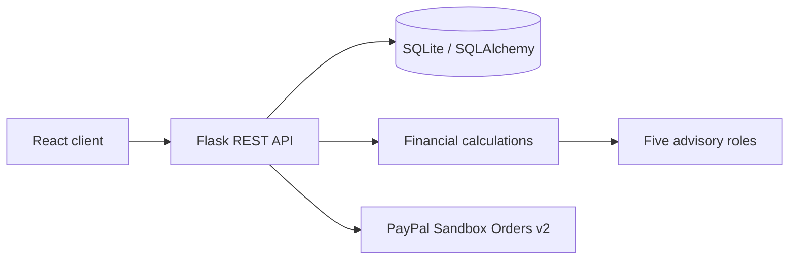

# Architecture

React + TypeScript (Vite) calls a Flask REST API backed by SQLite/SQLAlchemy. Deterministic finance calculations feed affordability scenarios. Five specialist roles summarize the relevant evidence; no agent can authorize payment.

''@ | Set-Content docs/ARCHITECTURE.md -Encoding utf8
@'
# API

Base URL `http://localhost:5000/api`; JSON except CSV upload.

- `GET /health`: service/payment readiness.
- `POST /auth/register`, `POST /auth/login`: JWT bearer auth.
- `GET /dashboard`: profile metrics and recent activity.
- `PUT /finances/profile`: signed-in profile update.
- `POST /transactions/import`: signed-in CSV (`date`, `amount`, optional `description`/`name`/`merchant`).
- `GET /products?q=`: curated catalogue search.
- `POST /analyze`: `{product,price}` returns affordability, scenarios, specialist findings.
- `POST /schedule`: signed-in price/date watch.
- `GET /payments/status`, `POST /payments/order`, `POST /payments/capture`: Sandbox payment flow.

`Authorization: Bearer <token>` is required for private operations. Password must contain at least eight characters.
