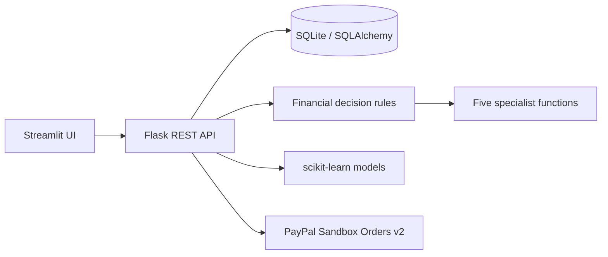

# Architecture

Streamlit is the user interface. It calls the Flask REST API; Flask uses SQLAlchemy and SQLite. Deterministic calculations own affordability and payment eligibility. Five specialist functions produce evidence-based findings; optional LLM providers explain the result but cannot change numeric values or authorize payment.

Optional background watch checks use APScheduler when `ENABLE_SCHEDULER=true`. SQLite tables are initialized on startup; schema changes use a small additive migration for user-entered product URLs.
