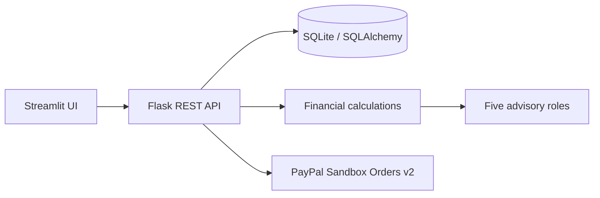

# Architecture

Streamlit is the user interface. It calls the Flask REST API over HTTP; Flask uses SQLAlchemy and SQLite. Deterministic finance calculations return affordability scenarios. Five specialist roles summarize relevant evidence. No agent authorizes a payment.

