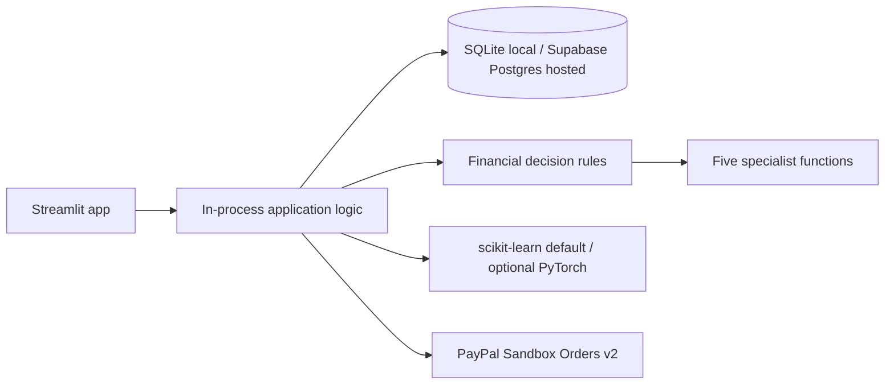

# Architecture

Streamlit is the user interface and deployment entry point. Its in-process adapter calls the existing Flask application logic without starting a separate API server or making a network request. Flask-SQLAlchemy stores data in local SQLite during development or Supabase Postgres in the hosted configuration. Deterministic calculations own affordability and payment eligibility. Five specialist functions produce evidence-based findings; optional LLM providers explain the result but cannot change numeric values or authorize payment.

The Flask routes remain available for API development and tests, but the deployed Streamlit app dispatches to them in-process. Optional background watch checks use APScheduler when `ENABLE_SCHEDULER=true`. Tables and the demo catalogue are initialized on startup; schema changes use a small additive migration for user-entered product URLs.
